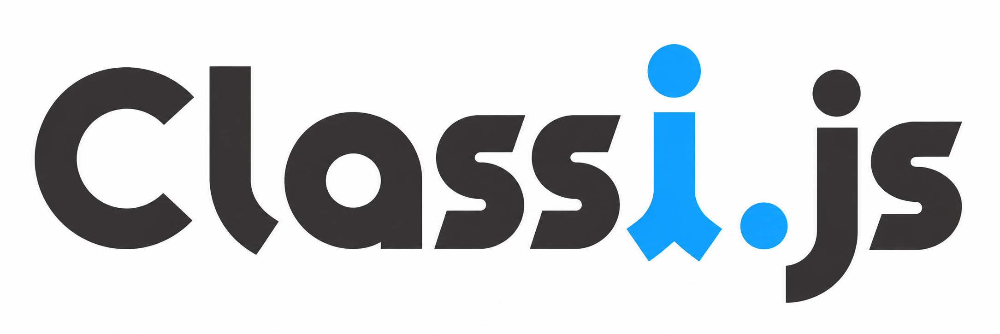

# classi.js



Classi (classi.jp) を Node.js / TypeScript から扱うための**非公式**の API クライアントです。

ログイン、課題（タスクトレーニング）の取得・回答送信、通知やグループメッセージの取得など、
Classi の Web 版の機能をコードから利用できます。

> ⚠️ このライブラリは非公式です。Classi 株式会社 / 株式会社ベネッセコーポレーションとは関係ありません。
> 必ず**自分のアカウント**で、迷惑のかからない範囲で使ってください。
> 内部実装は実際の通信の観察に基づいているため、Classi 側の更新で突然動かなくなることがあります。

## インストール

```bash
npm install classi.js
```

Node.js 18 以上を想定しています。実行時の依存パッケージはありません。
ビルドには開発用の依存パッケージである TypeScript を使います。

## はじめてのログイン

```ts
import { ClassiClient } from "classi.js"

const client = new ClassiClient({
  username: "your-id",
  password: "your-password",
})

await client.login()

const me = await client.training.currentUser()
console.log(`${me.userFullName} さん (${me.schoolId})`)
```

### 毎回のログインを省略する

一度ログインしたらセッションを保存して、次回から使い回せます。

```ts
import { readFileSync, writeFileSync } from "node:fs"

// 保存
await client.login()
writeFileSync("session.json", JSON.stringify(client.session), { mode: 0o600 })

// 復元（再ログイン不要）
const restored = ClassiClient.fromSession(
  JSON.parse(readFileSync("session.json", "utf8"))
)
await restored.training.currentUser()
```

`session.json` には認証済みの Cookie が含まれるので、**公開リポジトリにアップロードしないでください**。

## できること一覧

| プロパティ | 対象 | できること |
| --- | --- | --- |
| `client.id` | id-api.classi.jp | ログイン、アカウント情報、ユーザー名変更 |
| `client.training` | training-api.classi.jp | 課題、自習トレーニング、AI コーチのミッション・週次レポート、資格・就職・公務員対策 |
| `client.study` | study.classi.jp | 学習日報の読み書き、未記録者一覧、ランキング、GTZ 目標 |
| `client.platform` | platform.classi.jp | 通知、グループ・メッセージ、既読、ブックマーク、カレンダー、Web テスト、各種マスター |
| `client.portfolio` | portfolio.classi.jp | 活動記録、作品、アルバム、スペース、ストーリー・コメント |
| `client.karte` | karte.classi.jp | テスト結果、学習レポート |
| `client.video` | kuroko.classi.jp | カテゴリー別の動画一覧、動画情報・期限付き再生 URL |

## よくある使い方

### 課題の一覧を見る

```ts
const tasks = await client.training.studentTasks(2026, 9, false)
for (const t of tasks) {
  console.log(t.task.title, t.progressStatus)
}
```

### 問題に回答して結果を見る

```ts
if (!tasks.length) throw new Error("課題がありません")
const detail = await client.training.lessonStudentTask(tasks[0].id)
const topic = detail.learningTopics[0]
if (!topic?.nextQuestionSection) throw new Error("未回答の問題がありません")

const section = await client.training.questionSection(
  topic.nextQuestionSection.id
)
const q = section.questions[0]

const res = await client.training.submitAnswers(topic.id, {
  id: section.id,
  question_section_id: section.id,
  questions: [
    {
      id: q.id,
      answers: [{
        blank_symbol: null,
        answer_option_key: q.content.answerOptions![0].key,
      }],
    },
  ],
})

const result = await client.training.answerResult(res.answerId)
console.log("正解:", result.questionSection.questionAnswers[0].isCorrect)

const next = await client.training.nextQuestionSection(topic.id)
```

### 通知とメッセージ

```ts
const unread = await client.platform.unreadCount()
const groups = await client.platform.groups()
const messages = await client.platform.groupMessages(groups.groups[0].id)
await client.platform.markSeen("12975")
```

### 学習日報を書く

```ts
const form = await client.study.reportForm("2026-09-04")
await client.study.saveReportForm("2026-09-04", {
  ...form,
  satisfactionRate: { timeRating: "3", contentRating: "3" },
})
```

### 追加の読み取り API

以下のメソッドはデータの取得専用です。ミッションの作成・回答送信、
メッセージの送信や既読更新は行いません。

#### トレーニング

いずれも `client.training` のメソッドです。

- `todayMissions()`：今日のミッションと進捗
- `missions()`：ミッションの一覧
- `mission(id)`：ミッションの詳細
- `thisWeekDailyMission(id)`：指定したミッションの今週の状態
- `todayDailyMission(id)`：指定したミッションの今日の状態
- `weeklyReport(year, week)`：週次レポート
- `dailyMissionRecords(year, week)`：日別の取り組み記録
- `recommendedStudentTask()`：おすすめ課題と未完了件数
- `careerTrainingCategories(kind)`：公務員（`"koumuin"`）・就職（`"shushoku"`）対策のカテゴリー
- `qualificationTrainingCategories()`：資格対策のカテゴリー
- `koumuinQuestionSections(unitLevel3Id)`：公務員対策の小単元に属する問題一覧

`year` と `week` は ISO 週番号の年と週（1〜53）を指定します。
対象期間によってはサーバーが 400 を返すため、取得可能な過去の週を指定してください。

```ts
const missions = await client.training.missions()
if (missions.length) {
  const mission = await client.training.mission(missions[0].id)
  const status = await client.training.todayDailyMission(mission.id)
}
const weekly = await client.training.weeklyReport(2026, 45)
```

#### 学習日報・プラットフォーム

`client.study.unrecordedUsers("2026-09-04")` で、指定日の学習日報の未記録者を取得できます。

以下は `client.platform` のメソッドです。

- `webtestExaminations(page = 1)`：Web テストの配信一覧
- `webtestResults(page = 1)`：Web テストの結果一覧
- `searchTalkrooms()`：トークルームの一覧（本文なしの読み取り用 POST）
- `cbankStat()`：ファイル領域の使用量・容量上限
- `groupYears(displayThisYear = true)`：グループ一覧で選択できる年度
- `subjectList()`：教科のマスター
- `schoolageList()`：学校段階のマスター
- `questionnaireCategories()`：アンケートのカテゴリー
- `assignedQuestionnaires()`：配信されたアンケートの一覧
- `answeredQuestionnaires()`：回答済みアンケートの一覧
- `questionnaireInfo(distributionId, groupId)`：アンケートの配信情報・回答状態
- `questionnaireDetail(distributionId)`：アンケートの設問・選択肢などの詳細
- `bookmarks()`：ブックマークしたメッセージの一覧（要素型は `unknown`）

アンケートのメソッドは GET のみを使い、回答の開始・保存・送信は行いません。
配信 ID とグループ ID は一覧の `distribution_id` と `group_id` を指定します。
未開始のアンケートは詳細の取得を許可されない場合があります。
その場合も、自動で回答を開始することはありません。
`groups(year?)` と `newMessages(year?)` では年度を指定できます。
省略時は従来と同じリクエストになります。

`calendarEvents(startAt, endAt, eventType?)` の第3引数で `event_type` を指定できます。
省略した場合は従来どおりのリクエストになります。
`groupMessages()` の `group` は `GroupDetail` 型です。
一覧用の `GroupSummary` と異なり、`unread`・`sort_no` は持たず、
`member_count` や投稿・コメント・いいねの制限を表すフィールドを持ちます。

#### ポートフォリオ・動画

`client.portfolio.spaces(page = 1)` はスペース一覧、`stories(grade)` はストーリー一覧、
`storyCategories()` はカテゴリー、`storyComments(grade)` はコメント一覧を取得します。
`grade` には表示対象の学年を指定します。
空の配列しか確認できていない項目の要素型は `unknown` です。

以下も `client.portfolio` の読み取り専用メソッドです。

- `activityRecord(id)`：活動記録の詳細（文書・回答データと評価件数など）
- `templates()`：文書テンプレートの一覧
- `marks()`：マークの一覧
- `graduationMessageStatus()`：卒業メッセージの配信状態

動画サービスはログイン済みのセッションを共有します。
`videosByCategory(category, first = 100, after = null)` はカーソルによるページングに対応し、
`video(videoId, expireInSeconds = 300)` は動画情報と期限付き再生 URL を取得します。
動画が見つからない場合の戻り値は `null` です。

```ts
const videos = await client.video.videosByCategory(
  "CATEGORY_DAIGAKU_NYUSHI", 20
)
if (videos.nodes.length) {
  const video = await client.video.video(videos.nodes[0].id)
}
if (videos.pageInfo.hasNextPage) {
  const next = await client.video.videosByCategory(
    "CATEGORY_DAIGAKU_NYUSHI", 20, videos.pageInfo.endCursor
  )
}
```

カテゴリーには `"CATEGORY_KOUMUIN_SHIKEN"`、`"CATEGORY_OTHER"` も指定できます。
再生 URL は認証情報と同様に扱い、公開しないでください。
動画 API は HTTP 200 でも GraphQL の `errors` があれば `ClassiError` をスローします。

#### ログイン設定・カルテ

- `client.id.schoolLoginOptions()`：学校のロール別 CAPTCHA・メールによるパスワード再設定の設定
- `client.karte.tests(userId, kind, classroomId?)`：クラスを指定したテスト結果の一覧
- `client.karte.pathways(userId, type = 1, classroomsId?)`：クラスを指定した進路情報
- `client.karte.testDetail(userId, examId, params?)`：テスト結果の詳細
- `client.karte.trainingBenesseTestUrl()`：ベネッセのテスト・トレーニングへの遷移先 URL

`KarteTestSummary.kind` は数値または文字列です。
通常の結果には `detail.labels`・`detail.kind`、ベネッセの結果には
`detail.bc_results.exam` が含まれるため、各フィールドの有無を確認してください。
`testDetail` の第3引数では `name`、`exam_date`、`national_display_code`、
`prefecture_display_code`、`school_display_code`、`gtz_output_flg` を指定できます。
これらは一覧の `detail.bc_results.exam` から取得できます。
第3引数を省略した場合、従来どおりクエリなしで取得します。
遷移先 URL の取得では、その URL へのアクセスやリダイレクトの追跡は行いません。
返された URL には認証に関わる情報が含まれる可能性があるため、ログ出力・公開は避けてください。

## エラー処理

API が 2xx 以外のステータスコードを返すと `ClassiError` がスローされます。
`status` / `endpoint` / `body` を持つため、原因の切り分けに利用できます。

```ts
import { ClassiError } from "classi.js"

try {
  await client.training.lessonStudentTask(999999)
} catch (e) {
  if (e instanceof ClassiError) {
    console.error(`HTTP ${e.status} @ ${e.endpoint}`)
    console.error(JSON.stringify(e.body))
  }
}
```

| プロパティ | 型 | 内容 |
| --- | --- | --- |
| `status` | `number` | HTTP ステータスコード |
| `endpoint` | `string` | 呼び出した API のパス |
| `body` | `unknown` | サーバーからの生レスポンス |
| `message` | `string` | エラー内容の説明 |

### よくあるエラーと対処

| 状況 | 起きること | 対処 |
| --- | --- | --- |
| ID・パスワードの誤り | `ClassiError`（`invalid username or password`） | 認証情報を確認 |
| CSRF トークンの失効 | 422 が返る | トークンを自動で再取得（下記参照） |
| 存在しないリソース | 404 の `ClassiError` | ID の指定ミスがないか確認 |
| セッション切れ | 401 の `ClassiError` | `client.login()` で再ログインするか、セッションを作り直す |
| ネットワーク障害 | ネイティブの `TypeError` | `ClassiError` とは別型なので `instanceof` で判定してください |

training-api の更新リクエストでは、CSRF トークンが失効すると、
**内部で一度だけトークンを自動で再取得し、リクエストを再送**します。
手動でキャッシュを破棄するには `client.training.invalidateCsrf()` を呼び出してください。

## 開発者向け

```bash
npm ci          # 開発用の依存パッケージをインストール
npm run build   # TypeScript のビルド (dist/)
npm test        # オフライン回帰テスト + 認証情報がある場合のみ実 API テスト
```

回帰テストは認証情報なしで実行できます。
結合テストは実際のサーバーを使うため、認証情報を環境変数で渡してください（未設定の場合は結合テストのみスキップされます）。

```bash
CLASSI_USERNAME=your-id CLASSI_PASSWORD=your-pass npm test
```

## 変更履歴

各バージョンの変更点は [CHANGELOG.md](./CHANGELOG.md) を参照してください。

## License

MIT

---

❤️ Developed by **Nanachi** ([github.com/n4n45h1](https://github.com/n4n45h1))
& **GLM 5.3 Flash** (Z.ai)
